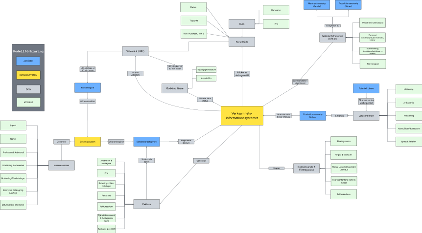

# digital-transformation-coded
# Digital Transformation Strategy & Realization Plan: CodEd AB

## 📌 Project Overview
This project was developed as part of the **Information Systems C / Business Process Modeling II** course at Uppsala University[cite: 145]. Acting as the IT management consultancy **NEWT AB**[cite: 292], our team was tasked with designing a complete Digital Transformation (DTX) strategy for CodEd AB, an educational company facing a severe profitability crisis[cite: 296, 308].

The project encompasses a full life-cycle analysis: diagnosing the root causes of the failing business model, formulating comprehensive IT requirements (divided into two phases), building a clickable web prototype, and creating a risk-assessed realization plan for the rollout[cite: 292].

---

## 🏢 Business Context & The Crisis (As-Is)
CodEd AB historically offered physical 2-day programming courses in Stockholm for professional developers[cite: 297, 300]. 

**The Core Problems:**
*   **Financial Crisis:** High fixed costs for central real estate combined with a drastically dropping attendance rate (from 15 to 6-7 participants per course) drained the company's capital[cite: 304].
*   **Outdated Value Proposition:** The course catalog lacked modern AI-development focus, which the market was demanding[cite: 307].
*   **Organizational Silos:** The founder (CEO) micromanaged all aspects. Existing IT systems (website, CRM, evaluation databases) were disconnected, resulting in administrative bottlenecks and a lack of data-driven insights[cite: 303, 306].

---

## 🚀 The Digital Transformation (To-Be)
To save the company, we designed a radical shift from a physical, location-bound model to a fully scalable, digital, and automated online business[cite: 296].

### Strategic Shifts:
1.  **New Value Proposition:** Shifted entirely to AI-based application and system development courses (VIBE coding, RAG, autonomous agents)[cite: 311, 329].
2.  **Remote Delivery:** Closed physical offices to eliminate fixed real-estate costs. Courses are now 100% video-mediated, taught by freelance AI experts working remotely[cite: 312].
3.  **Automated Business Engine:** Built a new centralized Business Information System (BIS) that automates the entire customer journey and administrative heavy-lifting[cite: 296].

---

## 🛠️ System Architecture & Prototyping (Fas 1 & Fas 2)
We translated the new business strategy into a high-level requirements specification and a conceptual data model, executed in two rollout phases. A fully clickable prototype was developed to validate the UI/UX.

*(Note: The visual models were originally created during the project. Below is a selection of the architectural structure.)*

### Phase 1: Core Automation
*   **Seamless Customer Journey:** The system handles automated B2B approvals. A participant registers, the system emails their manager for financial attestation, and upon approval, automatically generates an invoice and allocates the seat[cite: 313, 321].
*   **Freelancer Portal:** Automated recruitment and onboarding. Freelance teachers apply online, schedule automated video interviews (synced with management's calendar), and manage their availability[cite: 314, 322].
*   **Executive Dashboard:** Provided the new owners with real-time operational control. The dashboard tracks unique visitors, conversion funnels, revenue per course, and teacher margins, eliminating the old "gut-feeling" management style[cite: 316, 332].

 *(Example placeholder for conceptual model)*

### Phase 2: Retention & Change Management
*   **Automated Loyalty Loop:** Post-course, the system automatically emails evaluations. Upon completion, it dynamically generates discount codes (e.g., 20% off next course or 10% for a colleague) to drive recurring revenue[cite: 318, 335].
*   **No-Show Handling:** Automated email flows offering up to 3 alternative dates for participants who missed their scheduled session[cite: 319, 336].
*   **Flexible Teacher Status:** Self-service capabilities for teachers to pause or terminate their contracts, directly updating the automated allocation engine[cite: 320, 336].

---

## 📅 Realization Plan & Risk Management
To bridge the gap between the current state and the desired digital future, we formulated a 6-month realization plan divided into four sequential steps[cite: 340, 341]:

1.  **Technical & Pedagogical Foundation (Months 1-3):** Iterative coding of the IT platform and database. Parallel development of the new AI-pedagogy framework. Termination of the physical office lease[cite: 340, 343].
2.  **Organizational Shift (Months 3-4):** Opening the web portal to recruit the new fleet of freelance AI experts[cite: 340].
3.  **Onboarding & Testing (Month 5):** Conducting a mandatory 4-hour onboarding for new teachers and running pilot tests of the IT platform to ensure flawless invoicing and video-link generation[cite: 341].
4.  **Go-Live (Month 6):** Launching targeted web campaigns to drive professional developers into the newly automated conversion funnel[cite: 341].

### Key Risk Mitigation:
*   **System Failure during Launch:** Mitigated by strict pilot testing (Step 3) in a safe environment before rolling out to paying B2B customers[cite: 344].
*   **Teacher Churn:** Addressed by establishing dedicated "Superusers" and a structured onboarding process to lower the cognitive load for new remote teachers[cite: 344].

---

## 💡 Key Learnings & Critical Reflection
*   **The Importance of a "Resource Buffer":** A self-critical reflection of our realization plan revealed a heavy reliance on the two new owners (Johan and Camilla). Allocating them to all major tasks without a sufficient time buffer poses a severe risk of delays and budget overruns[cite: 355].
*   **Data Migration Risks:** The plan assumes seamless migration from the old CEO's fragmented databases. Without understanding the legacy data structure, migrating "dirty data" could paralyze the new automated systems[cite: 356].
*   **Applying DTX Principles:** Throughout the project, we applied 28 core Digital Transformation principles[cite: 288]. A major takeaway was that *IT implementation is rarely just a technical installation; it is fundamentally an organizational change.* Aligning the IT strategy with business goals (Strategic Alignment) and avoiding isolated solutions (Holistic View) were crucial in designing a system that actually creates value[cite: 252, 253, 288].

---
*Consultancy project executed by NEWT AB (fictional): David Palmér, Filip Sundberg, and Adam Larsson (2026).*[cite: 292]
